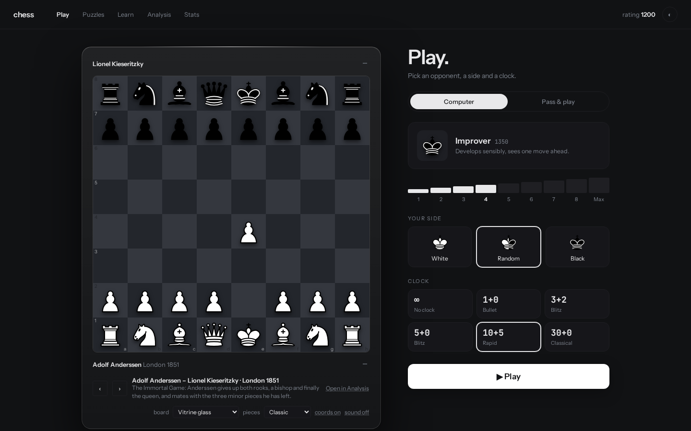

# chess

[](https://github.com/NeoGeoOne/chess/actions/workflows/ci.yml)
[](LICENSE)

Chess in the browser as a static site. Play the computer from beginner level up to full-strength Stockfish,
play a friend on the same device, solve daily puzzles, study openings and famous games, and analyse positions
with an engine. No account, no tracking, no requests to third-party servers: everything stays on the device.



## Features

- **Play the computer**: seven levels of a built-in engine plus Stockfish 10 at two strengths, with clocks
  and a rating that adapts after every game.
- **Pass & play** on one device, with automatic board flip.
- **Puzzles**: 2,000 engine-verified positions from the lichess puzzle database, a daily puzzle, theme and
  difficulty filters, and a puzzle rating.
- **Learn**: opening lessons and 50 famous games with move-by-move captions.
- **Analysis board**: Stockfish evaluation with depth, best line and highlighted move; FEN and PGN import.
- **Stats**: rating over time, game archive with PGN download, data export and import.
- Light and dark theme, several piece sets and board styles, keyboard-accessible controls, optional
  synthesized sounds, works on phones.

## Quick start

Requires Node.js 22 or newer.

```bash
npm install
npm test                                       # rules (perft), SAN/FEN/PGN, engine, games, puzzles
npm run build                                  # → dist/
python3 -m http.server 8941 --directory dist   # preview at http://127.0.0.1:8941/
```

`dist/` is a self-contained static site. All asset URLs are relative, so it can be served from any path.

## Project layout

```
src/
  template.html     UI template: edit this for layout and text
  render.gen.js     generated from template.html by tools/dc2jsx.mjs (do not edit)
  logic.js          app state and behaviour
  util.js           pure helpers: sanitizers, Elo, UCI parsing, PGN writers, puzzle labels
  engine.js         rules, FEN/SAN/PGN, evaluation and search of the built-in engine
  engine-worker.js  runs the built-in engine in a Web Worker
  sound.js          move, capture, check and clock sounds, synthesized with WebAudio
  puzzles.js        opening lessons
  puzzles.data.js   generated by tools/fetch-puzzles.mjs: the puzzle set
  games.js          generated by tools/fetch-games.mjs: the famous games
  main.js           entry point and error boundary
  index.html        page shell
  styles.css        base styles
public/             fonts, piece sets, Stockfish, icons (copied to dist/)
tools/              template compiler, build, data fetchers, Open Graph card
tests/              node:test suites
```

## Levels

| Level | Persona | Plays with | Rating |
|---|---|---|---|
| 1 | Beginner | built-in engine, depth 1, heavy noise | 200 |
| 2 | Novice | built-in, depth 1 | 550 |
| 3 | Casual | built-in, depth 1 | 900 |
| 4 | Improver | built-in, depth 1, light noise | 1350 |
| 5 | Club player | built-in, depth 2, 0.6 s | 1650 |
| 6 | Tournament player | built-in, depth 3, 0.6 s | 2050 |
| 7 | Expert | built-in, iterative deepening to depth 6, 1.2 s | 2300 |
| 8 | Master | Stockfish 10, Skill Level 9, 1 s | 2650 |
| Max | Stockfish | Stockfish 10, full strength, 1 s | 3500+ |

Ratings are an engine scale, measured with level-against-level matches and anchored to Stockfish's Skill Level to
Elo mapping: a level rated 300 points higher scores about 85 % against the one below. The engine never uses more
than a thirtieth of its remaining clock. Player and puzzle ratings use FIDE-style K-factors (40 for the first
30 rated games, then 20, and 10 from 2400).

## Privacy and security

- No cookies, no analytics, no external requests. Fonts, React, Stockfish and piece sets are bundled.
- Settings and stats are kept in the browser's `localStorage` (keys prefixed `chess_`) and validated on load.
- A Content-Security-Policy with a hash for the single inline script is generated at build time.

## Contributing

Bug reports and ideas are welcome as [issues](https://github.com/NeoGeoOne/chess/issues/new/choose).
Please read [CONTRIBUTING.md](CONTRIBUTING.md) before opening a pull request. Security issues:
see [SECURITY.md](SECURITY.md).

## Built with

React 18 and esbuild. The interface was designed in Claude Design, and the project is developed with AI coding
agents; [AGENTS.md](AGENTS.md) holds the rules they follow.

## License

The code is released under the [MIT License](LICENSE).
Bundled third-party assets keep their own licenses:

- Stockfish 10 (JavaScript build by Niklas Fiekas): GPL-3.0, [`public/engine/LICENSE-Stockfish-GPLv3.txt`](public/engine/LICENSE-Stockfish-GPLv3.txt)
- Piece sets (GPL-2.0+, Apache-2.0, MIT, CC BY 4.0, CC0): [`public/pieces/LICENSES.txt`](public/pieces/LICENSES.txt)
- Instrument Sans and JetBrains Mono: SIL Open Font License 1.1, [`public/fonts/`](public/fonts/)
- Puzzles: lichess puzzle database (CC0)
